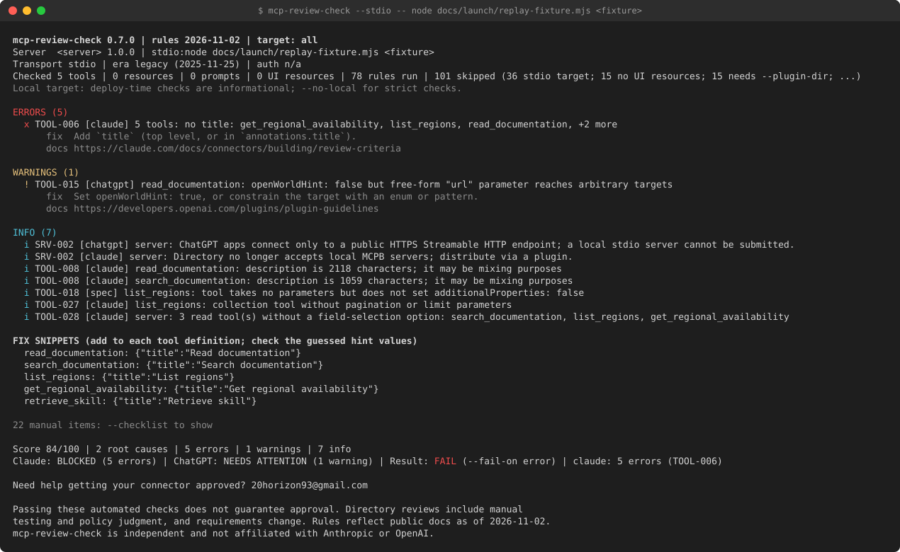

# mcp-review-check

Lint an MCP server against the public review criteria of the **Claude connector directory**, the **ChatGPT plugin directory** and the **MCP specification** before you submit it.

Run `npx mcp-review-check https://mcp.example.com/mcp` (no install, no account). Stdio servers, OAuth and CI: see [Usage](#usage), [Token recipe](#token-recipe) and [CI recipes](docs/guide/ci.md#ci-recipes).

<!-- The image path is relative, so it renders on GitHub only: npm does not ship docs/ (package.json "files"), and the npm page renders images from absolute URLs only. For npm use https://raw.githubusercontent.com/alisaosipova/mcp-review-check/main/docs/assets/sample-output.svg instead. -->
<p align="center">
  
</p>

<sub>A real run on a captured public listing, replayed offline; server and tool names redacted. Text version: [Example output](#example-output).</sub>

`mcp-review-check` connects to your server (remote Streamable HTTP, legacy HTTP+SSE, or local stdio), takes a snapshot of what it exposes (tools, resources, prompts, MCP Apps widgets, OAuth metadata), runs side-effect-free protocol probes, and checks everything against <!-- RULE_COUNT -->179<!-- /RULE_COUNT --> automated rules. Every rule links to its public source. Checks that cannot be automated are listed as a manual checklist (in full in markdown and JSON; one line in text unless you pass `--checklist`).

4 of 7 public MCP servers we captured (2026-10-22) miss a directory requirement on tool titles or annotations, or widget metadata ([method and caveats](https://github.com/alisaosipova/mcp-review-check/blob/main/docs/launch/aggregate-2026-11-03.md)).

- Requires Node 22.12 or newer; no telemetry.
- Read-only by default. It never calls your tools unless you pass `--active`, and then only tools annotated `readOnlyHint: true`.
- Text, JSON, Markdown, SARIF and JUnit output; an optional config file; CI-friendly exit codes.

## What it checks

| Category | Examples |
|---|---|
| **SRV** endpoint and deployment | HTTPS, public IPv4, tunnels, cross-host redirects, DNS-rebinding `Invalid Host`, Origin handling, WAF challenges, latency, server naming |
| **SPEC** protocol conformance | initialize / `server/discover` shape, declared capabilities, content types, 202 for notifications, session ids, version negotiation, error codes, `_meta` keys, icons, 2026-07-28 caching hints |
| **TOOL** tool metadata and schemas | name rules, titles, descriptions, parameter descriptions, `readOnlyHint` / `destructiveHint` / `openWorldHint`, contradictory or misleading hints, schema validity, catch-all HTTP tools, dispatchers, OpenAI `_meta` keys |
| **INJ** prompt injection | hidden Unicode, homoglyphs, HTML comments, encoded payloads, "ignore previous instructions", steering away from other tools |
| **DATA** data collection | conversation history, secrets, payment cards / government IDs, precise location |
| **POL** unsupported use cases | money transfer, AI media generation, ads and upsells, demo servers |
| **APPS** MCP Apps widgets | `ui://` links, MIME type, CSP coverage of the origins the HTML uses, widget domains (Claude hash and `openai/widgetDomain`), visibility, sandbox-blocked APIs |
| **AUTH** OAuth | 401 challenge, Protected Resource Metadata, AS metadata, issuer, PKCE S256, CIMD/DCR, grants, scopes, invalid-token handling, TLS, latency |
| **RT** runtime (opt-in) | error message quality, input validation, result size, latency, `structuredContent` vs `outputSchema`, leaked secrets, injection in output |
| **MAN** manual checklist | listing fields, privacy policy, screenshots, test accounts, test cases |

Severity follows one principle: **error** only when the source states a MUST or a rejection criterion *and* detection is deterministic; heuristics (regex or word lists) are at most **warning**.

## Quick start

Five minutes, no install and no account. The full path to a submission: [From zero to directory submission](docs/guide/walkthrough.md).

1. **Run it** against your server (Node 22.12 or newer):

   ```bash
   npx mcp-review-check https://mcp.example.com/mcp          # a deployed server
   npx mcp-review-check --stdio -- node dist/server.js       # a local stdio server
   ```

2. **Read the report.** Errors (`x`) are what a directory rejects; warnings are heuristics worth a look. The last lines give the verdict per directory (`BLOCKED`, `NEEDS ATTENTION` or `NO AUTOMATED BLOCKERS`) and the `Result:` line that sets the exit code. See [Example output](#example-output).
3. **Understand a finding**, then fix it: `npx mcp-review-check explain TOOL-011` prints the rationale, the sources and the fix. The report also prints copy-paste fix snippets for tool annotations.
4. **Run again** until the directory you submit to reads `NO AUTOMATED BLOCKERS`. `--target claude` or `--target chatgpt` gates on one directory.
5. **Put it in CI** with a baseline, so only new findings fail the build: [CI and automation](docs/guide/ci.md).

A server behind OAuth needs a test-account token for the tool checks ([Token recipe](#token-recipe)). Cannot connect or fetch? See [Troubleshooting](docs/guide/troubleshooting.md).

## Usage

```bash
# Remote server
npx mcp-review-check https://mcp.example.com/mcp

# OAuth-protected server: auth checks run without a token; tool checks need one
MCP_REVIEW_CHECK_TOKEN=... npx mcp-review-check https://mcp.example.com/mcp
npx mcp-review-check https://mcp.example.com/mcp --bearer "$TOKEN"

# Extra headers (values are always redacted in output)
npx mcp-review-check https://mcp.example.com/mcp --header "X-Tenant: acme"

# Local stdio server (spawned without a shell)
npx mcp-review-check --stdio "node dist/server.js --port 0" --env API_BASE=http://localhost:4000
# Same, with the command passed verbatim after `--` (options go before `--`)
npx mcp-review-check --env API_BASE=http://localhost:4000 --stdio -- node dist/server.js --port 0

# Only one directory, machine-readable output
npx mcp-review-check https://mcp.example.com/mcp --target claude --format json
npx mcp-review-check https://mcp.example.com/mcp --format sarif --output mcp-review.sarif

# Opt-in runtime checks: calls tools annotated readOnlyHint: true (max 3 calls per tool)
npx mcp-review-check https://mcp.example.com/mcp --bearer "$TOKEN" --active --tool-args args.json

# CI: fail on warnings too
npx mcp-review-check https://staging.example.com/mcp --fail-on warning

# CI: gate on the Claude directory and on MCP spec conformance
npx mcp-review-check https://staging.example.com/mcp --target claude --fail-on-spec

# Why does a rule exist? Severity per directory, rationale, sources and the fix
npx mcp-review-check explain TOOL-011
npx mcp-review-check --list-rules TOOL --format json
```

On a machine without access to the npm registry, where `npx` cannot fetch the package, run it from a checkout: `npm install && npm run build`, then `node dist/cli.js <url>` or `npm link`. The same applies to every `npx -y mcp-review-check@0.7` line in [CI recipes](docs/guide/ci.md#ci-recipes) and [Docker Compose](docs/guide/ci.md#docker-compose): replace it with `node path/to/mcp-review-check/dist/cli.js`.

mcp-review-check is a command-line tool only: the package has no supported programmatic API yet (its `exports` field exposes only `package.json`, so `import 'mcp-review-check'` and deep imports of `dist/` fail), and its internal modules may change in any release.

## GitHub Action

```yaml
      - uses: actions/setup-node@v5
        with:
          node-version: 22
      - uses: alisaosipova/mcp-review-check@v0.7.0
        with:
          target: https://staging.example.com/mcp     # or stdio: node dist/server.js
          platform: claude
          bearer: ${{ secrets.MCP_REVIEW_CHECK_TOKEN }}
```

Annotations, the job summary and a SARIF upload to code scanning (needs `security-events: write`). Every input and
output, with defaults: [CI and automation](docs/guide/ci.md#ci-recipes).

There is no moving `v0` ref: pin a full release tag (as above) or a commit SHA.

### Badge: "no automated blockers"

How to set up a badge for your own server's README (this repository has no live badge). It shows the verdict of the
last run on your default branch, written by your workflow to a gist and served by a shields.io endpoint:

1. Create a public gist with one file, `mcp-review-check.json`.
2. Store a token that can write gists as the secret `BADGE_GIST_TOKEN` and the gist id as the variable `BADGE_GIST_ID`.
3. Give the Action step `id: review` and add the badge step from [docs/launch/badge.md](docs/launch/badge.md#mechanism) after it. It
   maps `verdict-claude` to "no automated blockers" (green), "needs attention", "blockers found" or "incomplete", and
   runs on pushes and schedules only, never on pull requests.

```markdown
[](https://github.com/OWNER/REPO/actions/workflows/mcp-review-check.yml)
```

Replace `USER`, `GIST_ID`, `OWNER`, `REPO` and the workflow file name. "No automated blockers" covers only what the
automated rules detect: it does not mean a directory will accept the server.

## Exit codes

| Code | Meaning |
|---|---|
| 0 | Completed, below the `--fail-on` threshold |
| 1 | Completed, threshold reached for a `--target` directory (or for the spec with `--fail-on-spec`), or a tool definition changed with `--fail-on-drift` |
| 2 | Usage or configuration error, or an output file could not be written |
| 3 | Could not reach the server or complete a handshake; with `--fail-on-incomplete`, a partial check |
| 4 | `--max-duration` stopped the check after the handshake |
| 128+N | Ended by signal N (130 for Ctrl+C, 143 for SIGTERM) |

Details, partial checks and the `Result:` line: [Options, config file and output formats](docs/guide/options-and-config.md#exit-codes).

## Token recipe

A server that answers `401` gets the auth checks without a token; tool, resource and UI checks need an access token for a **test account**, issued for this server (ask your authorization server for the server URL as the `resource`, [RFC 8707](https://www.rfc-editor.org/rfc/rfc8707.html)). Pass it in `MCP_REVIEW_CHECK_TOKEN`: it stays out of shell history and is redacted in every output.

```bash
MCP_REVIEW_CHECK_TOKEN=... npx mcp-review-check https://mcp.example.com/mcp
```

How to get the token, and what "Server rejected the token (401)" means: [Authentication](docs/guide/auth.md).

## Example output

```
mcp-review-check 0.7.0 · rules 2026-11-02 · target: all
Server  repo-wiki 0.1.0 · https://mcp.wiki.example/mcp
Transport streamable-http · era legacy (2025-11-25) · auth none
          2026-07-28 clients fall back to initialize. Not a defect.
Checked 3 tools · 0 resources · 0 prompts · 0 UI resources · 90 rules run · 54 skipped (16 server did not request auth; …)

ERRORS (9)
  x TOOL-006 [claude] 3 tools: no title: ask_question, read_wiki_contents, read_wiki_structure
      fix  Add `title` (top level, or in `annotations.title`).
      docs https://claude.com/docs/connectors/building/review-criteria
  x TOOL-011 [claude] 3 tools: neither readOnlyHint nor destructiveHint is set: ask_question, read_wiki_contents, read_wiki_structure
  ...
  x TOOL-012 [chatgpt] 3 tools: missing readOnlyHint, destructiveHint, openWorldHint: ask_question, read_wiki_contents, read_wiki_structure
  ...

INFO (2)
  i TOOL-005 [chatgpt] ask_question: name contains no recognizable verb
  ...

FIX SNIPPETS (add to each tool definition; check the guessed hint values)
  read_wiki_structure: {"title":"Read wiki structure","annotations":{"readOnlyHint":true,"destructiveHint":false,"openWorldHint":true}}
  read_wiki_contents: {"title":"Read wiki contents","annotations":{"readOnlyHint":true,"destructiveHint":false,"openWorldHint":true}}
  ask_question: {"title":"Ask question","annotations":{"readOnlyHint":false,"destructiveHint":true,"openWorldHint":true}}

22 manual items: --checklist to show

Score 64/100 · 3 root causes · 9 errors · 0 warnings · 3 info
Claude: BLOCKED (6 errors) · ChatGPT: BLOCKED (3 errors) · Result: FAIL (--fail-on error) · claude: 6 errors (TOOL-006, TOOL-011); chatgpt: 3 errors (TOOL-012)
```

Three tools without a title or annotations make 9 findings but 3 root causes: the score is `100 − 3 × 12 = 64`, and pasting the fix snippets clears all of them.

The protocol revision is in the header (the SRV-020 finding stays in JSON and SARIF only), and the TOOL-013 info about `idempotentHint` on a read-only tool is shown only with `--verbose`. Findings with the same rule and message are collapsed into one line with a count (`--verbose` lists each one), and every tool without a title or annotation hints gets a JSON fragment to paste in. The score counts root causes, not findings: `100 − 12` per rule with an error `− 4` per rule with only warnings, not below 0 (JSON `summary.scoreVersion: 2`); it is provisional. The score is one number per server: it counts the findings of every platform whatever `--target`, and so does the root-cause count next to it (JSON `summary.rootCauses`); findings of `--ignore`d rules are left out of both, while the listed findings, the verdicts and the exit code follow `--target`. Per-platform verdicts are `BLOCKED`, `NEEDS ATTENTION` or `NO AUTOMATED BLOCKERS`. When tool-level checks cannot run (OAuth without `--bearer`, a failed connect or a failed `tools/list`), the score is `n/a` and a verdict without errors is `INCOMPLETE`, never a pass; after a failed connect every verdict is `INCOMPLETE`.

## Guide

The detailed reference lives in [docs/guide/](docs/guide/). It stays on GitHub and is not part of the npm package.

| Page | What is in it |
|---|---|
| [From zero to directory submission](docs/guide/walkthrough.md) | First run, reading the report, `explain`, fixing, re-running, `--active`, a baseline in CI, the manual checklist, submission |
| [Options, config file and output formats](docs/guide/options-and-config.md) | Every option, the config file, output formats, JSON Schema, drift and baselines, exit codes, local mode |
| [CI and automation](docs/guide/ci.md) | GitHub Actions and the GitHub Action, GitLab CI, Docker, Docker Compose, pre-commit |
| [Authentication](docs/guide/auth.md) | The token recipe and OAuth-protected servers |
| [Listing and plugin manifests](docs/guide/listings.md) | `--plugin-dir` and `--openai-manifest` |
| [What the tool sends, privacy and redaction](docs/guide/privacy-and-requests.md) | Requests, privacy, how secrets are redacted |
| [Troubleshooting](docs/guide/troubleshooting.md) | Connection, TLS, proxy, WAF, timeouts, Windows, false positives |

## Rules

The full catalog, every rule with its severity per platform and its public source, and the manual checklist, is in [docs/RULES.md](docs/RULES.md), generated from the code (`npm run build && npm run readme:rules`). `mcp-review-check --list-rules` prints it, and `mcp-review-check explain <RULE-ID>` explains one rule.

## Compared with other tools

As of 2026-10-23; each statement links to the tool's own documentation, checked on that date. The tools answer different questions and can run side by side.

| Tool | What it does, per its documentation | Use it for |
|---|---|---|
| [MCP Inspector](https://github.com/modelcontextprotocol/inspector) | Connects to a server from a web UI, a terminal UI or a [scriptable CLI](https://github.com/modelcontextprotocol/inspector/blob/main/clients/cli/README.md) to list and call tools, read resources and get prompts; the CLI has exit codes for [CI smoke tests](https://github.com/modelcontextprotocol/inspector/blob/main/docs/cli-smoke-testing.md) and runs the OAuth sign-in | Trying your server by hand; asserting that a tool call returns what you expect |
| [MCP conformance](https://github.com/modelcontextprotocol/conformance) | Tests [client and server implementations against the MCP specification](https://github.com/modelcontextprotocol/conformance#readme) by scenario | Full protocol conformance (mcp-review-check suggests it in MAN-031) |
| [Snyk Agent Scan](https://github.com/snyk/agent-scan), formerly [`mcp-scan`](https://pypi.org/project/mcp-scan/) | Discovers the agents, MCP servers and skills [installed on a machine](https://github.com/snyk/agent-scan#readme) and scans them for prompt injection and other threats; needs a Snyk API token | Auditing the MCP servers you use |
| mcp-review-check | Checks one server against the public review criteria of the Claude and ChatGPT directories and the MCP spec, with a source link per rule and a manual checklist; no account | Getting your own server ready for a directory submission |

## Related

[LureKit](https://github.com/alisaosipova/lurekit), by the same author, is a security benchmark for deployed
coding-agent setups (agent, model, permission mode, settings, MCP servers, hooks, skills): it replays scenarios
derived from public disclosures with inert fixtures. mcp-review-check checks the server you publish, LureKit checks
the agent setup you run.

## FAQ

**Does a clean report mean the directory will accept my server?** No. Reviews include manual testing and policy judgment, and the rules reflect the public criteria as of the catalog date (see [Limitations and disclaimer](#limitations-and-disclaimer)). The manual checklist lists what the tool cannot check.

**A finding looks wrong for my server. What now?** `mcp-review-check explain <RULE-ID>` shows why the rule exists and its sources; `--ignore <RULE-ID>` drops it from the exit code and from the score (it stays in JSON under `ignored`), so compare scores only between runs with the same `--ignore` list. Heuristic rules are capped at warning and can be wrong; please report a false positive with the JSON report attached.

**Why did the run exit 3?** It could not connect or complete a handshake (`Result: FAIL (could not connect)`), or, with `--fail-on-incomplete`, the check was partial (no token, a rejected token, `tools/list` failed), or the linter itself failed (`fatal:` with a stack trace on stderr: a bug in mcp-review-check, please report it). The report names the cause (the name does not resolve, connection refused or timed out, an untrusted TLS certificate, not an MCP endpoint) and, where it can, a URL to try. Exit 4 means `--max-duration` stopped the check after the handshake (`Result: INCOMPLETE (stopped at --max-duration during <phase>)`): raise the deadline or find the slow phase. See [Exit codes](#exit-codes).

**Why does `--target claude` pass with MCP spec errors?** The exit code counts only the chosen directories; add `--fail-on-spec` to fail on spec findings too.

**My server is on localhost or in a container. Is HTTPS a problem?** No: such hosts run in [local mode](docs/guide/options-and-config.md#local-mode), where deploy-time checks are info. `--no-local` makes them strict.

**My server needs OAuth.** See [Token recipe](#token-recipe). Without a token the auth checks still run and the score reads `n/a`.

**Does it change anything on my server?** Not by default; see [What the tool sends](docs/guide/privacy-and-requests.md#what-the-tool-sends). `--active` calls read-only tools and `--active-auth` registers a DCR client.

## Stability policy

The rule catalog is dated <!-- CATALOG_DATE -->2026-11-02<!-- /CATALOG_DATE --> (shown as `rules <date>` in every report header and as `tool.catalogDate` in JSON, with `tool.catalogAgeDays`). A check run prints a warning on stderr when the catalog is more than 90 days old, because directory requirements change.

From 1.0.0 the project follows [semantic versioning](https://semver.org/). The public interface is the command line only (there is no programmatic API): options, config keys, exit codes, the JSON report, the SARIF and JUnit output, and rule IDs.

- **MAJOR** (2.0.0, ...) is required to remove or rename a CLI option or config key, to change the meaning of an exit code, to remove or rename a field of the JSON report (`schemaVersion` is bumped) or change the SARIF or JUnit structure incompatibly, to remove a rule, or to raise the minimum Node version.
- **MINOR** (1.1.0, ...) adds rules, raises severities, and adds options, config keys, report fields and output formats. A new rule or a higher severity can turn a `--fail-on` gate red, so read [CHANGELOG.md](CHANGELOG.md) before upgrading a minor.
- **PATCH** (1.0.1, ...) fixes bugs and false positives, lowers severities and improves messages. A patch never adds a rule or raises a severity, so it cannot turn a passing CI run red.
- **Rule IDs are never reused.** A retired rule's ID stays retired, so `--ignore` lists and saved reports keep their meaning.
- **JSON output** carries `schemaVersion` (currently `1`). It changes only when a field is renamed, removed or changes type; new fields can appear in any minor release.

Not covered by the policy, and free to change in any release: the wording of messages and fix hints, score values, the heuristics inside a rule (word lists, regexes, thresholds; they are capped at warning), the text of the manual checklist, the layout of the human-readable report, and every internal module (the package exports a CLI, not a library).

In CI, pin the minor version so that new rules arrive when you choose to upgrade: `npx mcp-review-check@1.0 <url>`.

## Limitations and disclaimer

- Passing these automated checks **does not guarantee approval**. Directory reviews include manual testing and policy judgment, and requirements change. Rules reflect public documentation as of <!-- CATALOG_DATE -->2026-11-02<!-- /CATALOG_DATE -->.
- Heuristic rules (word lists and regexes for injection, data collection, policy topics and tool shapes) can produce false positives and miss real problems. They are capped at warning; only deterministic markers (hidden characters, explicit "ignore previous instructions" or "don't tell the user", conversation-history and secret parameter names) are errors.
- Tool-level checks on OAuth-protected servers need a valid `--bearer` token; without one only the auth checks run.
- `--stdio` launches the server with your local Node. A server whose `engines` needs a newer Node fails at startup (exit 3); run the check under that Node version, or pass `--env NODE_OPTIONS=...` when a flag is enough.
- `--stdio` ends the server with everything it started, also behind `npx`, a `.cmd` or `.bat` file or `sh -c`: on Windows the process tree (`taskkill /T /F`), on Linux and macOS the server's process group (the server runs as its leader, so a terminal's Ctrl+C reaches the CLI, which ends the group on SIGINT, SIGTERM, SIGHUP and SIGQUIT, and kills it at once on a second signal). A process the server moves to a group or session of its own (a daemon) is not ended. On Linux and macOS the CLI's own SIGKILL (`kill -9`, a timeout or CI job cancellation that kills the CLI's group) cannot be caught, so it does not end the server's group: a server that ignores stdin EOF outlives it. The server also runs in a session of its own, without the terminal: a `--stdio` wrapper that prompts on the terminal (ssh asking for a password or to confirm a new host key, sudo) cannot prompt and fails, so use ssh with a key, `-o BatchMode=yes` and a host key already in `known_hosts`, and sudo without a password.
- DNS checks use the system resolver. Registrable-domain logic uses a small built-in suffix list, not the full Public Suffix List.
- Widget origin extraction is regex-based; origins built at runtime are not detected.
- Listing and plugin manifests are linted only for what can be read offline (see [Listing and plugin manifests](docs/guide/listings.md#listing-and-plugin-manifests)); screenshots, image sizes and the portal form stay in the manual checklist. For full wire-schema conformance, also run `npx @modelcontextprotocol/conformance`.
- mcp-review-check is independent and not affiliated with Anthropic or OpenAI.

## Development

```bash
npm install
npm run build        # tsc → dist/
npm run typecheck    # tsc --noEmit over src/ and test/
npm test             # vitest: rule unit tests, fixture servers, e2e, auth probe
MCP_REVIEW_CHECK_LIVE=1 npm test   # adds smoke tests against public servers
npm run test:coverage   # the same tests with a coverage report of src/ in coverage/
```

See [CONTRIBUTING.md](CONTRIBUTING.md) for how to add a rule, [SECURITY.md](SECURITY.md) for what the tool sends, the threat model and how to report a vulnerability, and [docs/design/spec.md](docs/design/spec.md) for the original design document (it may differ from the implementation).

Test fixtures live in `test/fixtures/`: a compliant stdio server (`good-server.mjs`), a server that violates many rules (`bad-server.mjs`), an HTTP bridge with switches for wire-level defects, an OAuth metadata server with good and bad variants, and a raw 2026-07-28 server.

## License

MIT
