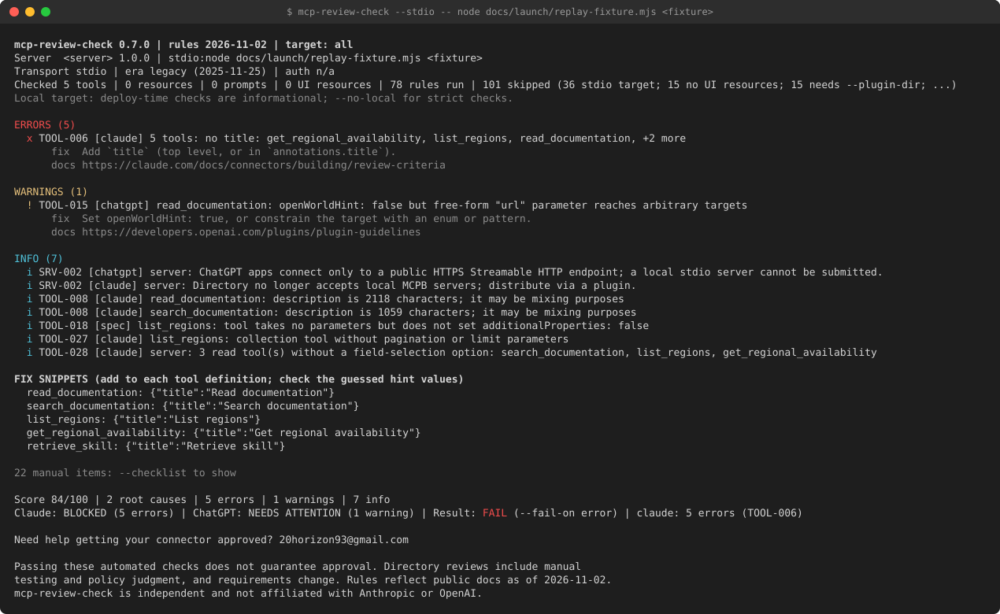

# Visual first screen: show a rendered run above the fold

Draft for review. Nothing here edits README.md.

## Problem

A visitor reads the title, one sentence and a `npx` line, then a table of rule categories (README.md lines 1-28).
The first rendered report is under `## Example output`, far below the fold. In 10 seconds the visitor cannot see
what the tool prints: findings with fixes, a score and a per-directory verdict.

## What was produced

| File | What it is | How it was made |
|---|---|---|
| `docs/launch/sample-output.ansi` | The raw ANSI text of one real CLI run, redacted | Command below, then the redaction map |
| `docs/launch/sample-output.txt` | The same text with the ANSI codes stripped | `sed 's/\x1b\[[0-9;]*m//g'` on the `.ansi` file |
| `docs/assets/sample-output.svg` | A static terminal mock of the `.ansi` file, 1270x780, 5501 bytes, pure ASCII | `node docs/launch/render-svg.mjs docs/launch/sample-output.ansi docs/assets/sample-output.svg` |
| `docs/launch/replay-fixture.mjs` | A local stdio MCP server that serves a captured listing from `test/fixtures/real/` | Written for this draft; no network |
| `docs/launch/render-svg.mjs` | The ANSI-to-SVG generator (SGR 0, 1, 2, 31, 33, 36 only) | Written for this draft |

Sizes and dimensions are from the output of `render-svg.mjs` and `wc -c`.

### The run

The CLI cannot read a fixture file directly, so the captured listing is served by a local stdio replay server and
the unmodified CLI (`dist/cli.js`, version 0.7.0 from package.json) connects to it. Offline: no request leaves the
machine.

```bash
npm run build
FORCE_COLOR=1 node dist/cli.js --stdio -- node docs/launch/replay-fixture.mjs test/fixtures/real/<fixture>.json > raw.ansi
# exit code 1 (Result: FAIL), stderr empty
```

The fixture is one of the public no-login servers captured on 2026-10-22 (see `test/fixtures/real/NOTICE.md`).
It was chosen because its run shows all three severities and two different verdicts. Its name is not given here.

### Redactions applied (and nothing else)

The output is the CLI's exact stdout except for these substitutions, applied to the `.ansi` file before stripping:

1. The fixture path in the `Server` line -> `<fixture>`.
2. The server's `serverInfo.name` -> `<server>`.
3. A vendor prefix on every tool name removed (for example `<prefix>read_documentation` -> `read_documentation`).
4. In the fix snippets, the vendor word at the start of each guessed title removed and the next word capitalised
   (the CLI derives the title from the tool name, so this is what it prints for the redacted name).
5. ASCII only: U+00B7 (middle dot, the CLI's field separator) -> `|`, and U+2026 (ellipsis) -> `...`. The real
   terminal shows the middle dot and the ellipsis.

Kept as is: the rule IDs, messages, counts, score, verdicts and result.

### What the sample shows (from `docs/launch/sample-output.txt`)

- 42 lines, widest line 153 columns (`wc -l`, `awk` over the file).
- `ERRORS (5)`, `WARNINGS (1)`, `INFO (7)`, then `FIX SNIPPETS` with 5 copy-paste titles.
- `Score 84/100 | 2 root causes | 5 errors | 1 warnings | 7 info`
- `Claude: BLOCKED (5 errors) | ChatGPT: NEEDS ATTENTION (1 warning) | Result: FAIL (--fail-on error) | claude: 5 errors (TOOL-006)`

Because the replay is a stdio server, the header says `Transport stdio` and the local-mode banner and two SRV-002
info lines appear; a run against a deployed HTTPS server would show `streamable-http` instead.

### Colours (from `src/report/text.ts`)

The SVG uses exactly the CLI's SGR codes: the header line bold; `ERRORS` and the `x` mark red (31); `WARNINGS` and
`!` yellow (33); `INFO` and `i` cyan (36); `fix`, `docs`, the local banner and the manual-items line dim (2);
`FIX SNIPPETS` bold. On the verdict line only the word `FAIL` (or `INCOMPLETE`) is coloured, red; the verdict
words `BLOCKED`, `NEEDS ATTENTION` and `NO AUTOMATED BLOCKERS` are printed uncoloured, and the SVG keeps that.

## Decisions for you before publishing

1. **The contact line.** The run prints `Need help getting your connector approved? <your email>` (the CTA in
   `src/report/constants.ts`, shown on a BLOCKED verdict). It is in the `.txt`, `.ansi` and the SVG because it is
   real output. To drop it, re-capture with `MCP_REVIEW_CHECK_NO_CTA=1` and re-run `render-svg.mjs`.
2. **The disclaimer** (3 lines) is also real output and stays in the image; it is a fair thing to show.
3. **Height.** 42 lines is tall for a first screen. A shorter variant: capture with `--quiet` (only errors and
   warnings, the score and the verdict line). Not produced here; same commands with `--quiet` added.

## README placement proposal

Put the image directly after the one-line description and the `npx` line, before the long paragraph: that is
after README.md line 5 (`Run \`npx mcp-review-check ...\``) and before line 7 (`\`mcp-review-check\` connects to
your server ...`). The visitor then sees the title, what it does, how to run it and what it prints, in the first
scroll.

Snippet (a relative path, so it renders on GitHub; npm does not ship `docs/`, so for the npm page use the absolute
raw URL variant below):

```markdown
<p align="center">
  
</p>

<sub>A real run on a captured public listing, replayed offline; server and tool names redacted. Text version: [Example output](#example-output).</sub>
```

npm variant (the npm README renders images from absolute URLs only; `docs/` is not in the package `files`):

```markdown

```

Keep `## Example output` as the text version: it is searchable and readable without images.

## asciinema recording recipe (needs a TTY, so for you to run)

asciinema is not installed on this host (`command -v asciinema` printed nothing). The recording is optional: the
SVG already covers the README without media playback.

What to record: one command and its full report, about 15-25 seconds; no typing mistakes, no shell prompt with
your hostname or paths.

Which server: the synthetic `test/fixtures/bad-server.mjs` (project-owned, no third-party names; 143 lines in full,
42 with `--quiet`, from `wc -l`), or your own server. Do not record the replay of a `test/fixtures/real/` file
unredacted: it would show a third-party server's name.

```bash
# 1. Install (Kali): asciinema; agg only if you also want a GIF
sudo apt install asciinema
# optional GIF renderer: cargo install --git https://github.com/asciinema/agg

# 2. Prepare a clean shell, 120x32 terminal
cd ~/packages/mcp-review-check && npm run build
export PS1='$ ' COLUMNS=120 LINES=32

# 3. Record (Ctrl+D or `exit` ends it); --idle-time-limit caps pauses at 2 s
asciinema rec --idle-time-limit 2 --title "mcp-review-check" docs/launch/demo.cast
#    inside the recording, type:
#    node dist/cli.js --quiet --stdio -- node test/fixtures/bad-server.mjs
#    exit

# 4. Check it locally before sharing
asciinema play docs/launch/demo.cast
grep -c "$(hostname)" docs/launch/demo.cast   # expect 0

# 5. Optional GIF (large; the SVG is usually better for the README)
agg --theme monokai --font-size 14 docs/launch/demo.cast docs/assets/demo.gif
```

Where to upload: `asciinema upload docs/launch/demo.cast` publishes it to asciinema.org (needs a network call and,
to keep it under your account, `asciinema auth` first). Link it from the README as a thumbnail that opens the
player:

```markdown
[](https://asciinema.org/a/<id>)
```

Alternatives: attach the `.cast` or GIF to the GitHub release, or keep only the SVG. Commit the `.cast` only if you
want it in the repo (it is plain text, a few KB).

## Regenerating

```bash
npm run build
FORCE_COLOR=1 node dist/cli.js --stdio -- node docs/launch/replay-fixture.mjs test/fixtures/real/<fixture>.json > raw.ansi
# apply the redaction map above, then
sed 's/\x1b\[[0-9;]*m//g' docs/launch/sample-output.ansi > docs/launch/sample-output.txt
node docs/launch/render-svg.mjs docs/launch/sample-output.ansi docs/assets/sample-output.svg
```
